# dsh-liquid-glass

把 macOS 26/27 的 **Liquid Glass** 视觉语言移植到 DeepSeek Harness 的 Web 界面上：
浮起的磨砂玻璃面板、被玻璃折射的极光壁纸、按下时的液态回弹，以及按 Apple 规范补全的输入框状态。

> 纯客户端插件：只注入 CSS + 极少量 DOM/指针逻辑，不碰 Host 服务、不发网络请求、不改任何业务数据。
> 在 DSH `0.2.1-rc.2` 上开发并验证。

---

## 1. 它做了什么

DSH 原本是"白色实心面板 + 无背景"的桌面工具界面。这个插件把它换成 macOS Tahoe 之后的
玻璃语汇，分四层叠加：

| 层 | 作用 | 实现 |
| --- | --- | --- |
| **壁纸层** `#lg-wall` | 玻璃需要有东西可以"透"和"折射"。一张内联 SVG 极光壁纸：蓝 → 紫 → 青三层**横向色带**（自上而下）+ 白色高光带 + 噪点，亮/暗两套 | `lib/client.js` 里的 `--lg-wall-image` |
| **材质层** | 侧边栏、内容列、输入框、菜单、弹窗全部变成半透明玻璃：`backdrop-filter: blur() saturate() brightness()` + 白色薄膜 + 顶部 1.5px 高光边 + 0.5px 描边 + 大范围柔和投影 | `src/glass.css` |
| **折射层** | 内容列的 `::before` 是同一张壁纸的**放大 1.12 倍**副本，用 `mask-composite` 裁成 26px 的边带，边缘露出一圈被"折弯"的背景色。侧栏只有 270px 宽，同样的 26px 边带会变成彩色描边，所以侧栏单独用 10px / 0.18 的窄边 | `::before` + `background-attachment: fixed` |
| **交互层** | 按下按钮时 `data-lg-press` 触发液态压感；面板每 19s 扫过一道极光。**不做**跟随光标的高光（旧版有，已按要求移除） | `src/client.template.js` |

> 壁纸为什么是**横向**色带而不是四角色块：早期的四角构图把一大团蓝色压在左侧栏背后，
> 左栏偏蓝、内容区偏白，看起来就是"色差"。改成同高度同色相后，任意一列在任意高度都是
> 同一个色调，玻璃透出的颜色才整屏一致。

颜色全部来自现存的设计令牌（`--dsw-alias-bg-*`、`--dsw-menu-surface-fill`、`--dsw-menu-backdrop-filter` 等），
插件只是把它们**换成同色系的半透明版本**，所以换主题、换强调色时玻璃会自动跟着变。

## 2. 安装 / 卸载

档案（profile）为 `web` 时：

```powershell
# 安装（本目录就是插件包）
#   DSH 设置 → 插件 → 从本地目录安装 D:\harness\dsh-liquid-glass
# 或由 Agent 调用 plugin_manager install_bundle

# 卸载
#   DSH 设置 → 插件 → 停用 / 移除 dsh-liquid-glass
```

安装后**刷新页面**（Ctrl+R）即可看到效果；停用后所有注入的样式、壁纸、事件监听会被一次性回收，
界面回到原生状态（`apply()` 返回的 disposer 负责清理）。

## 3. 文件结构

```
dsh-liquid-glass/
├─ package.json          # dsh.client / dsh.bundle 声明
├─ cordis.patch.yml      # 把 Host 半身插入 loader
├─ lib/
│  ├─ index.js           # Host 半身：无服务依赖，仅占位（客户端才是效果本体）
│  └─ client.js          # 构建产物：CSS + 客户端行为（勿手改）
├─ src/
│  ├─ glass.css          # 材质、折射、令牌、弹窗（唯一需要手改的样式源）
│  └─ client.template.js # 客户端半身模板，__LIQUID_GLASS_CSS__ 由构建注入
├─ tools/build.mjs       # 无打包器：模板 + CSS → lib/client.js
└─ docs/                 # 效果截图
```

## 4. 开发循环

```powershell
node tools/build.mjs            # 重新生成 lib/client.js
```

DSH 的 `clientModules` 会通过 HMR 监视已登记客户端的文件；改动 `lib/client.js`（mtime/size 变化）后
刷新页面即可看到新版本，**不需要重启 Harness**。若已装到 `.generations/live/<pkg>+<ver>+<hash>/`，
需要把新产物同步到该目录，HMR 才会发布新的 rev。

## 5. 已知边界

- **只要 Chromium/Electron**（`backdrop-filter`、`mask-composite`、`corner-shape`）。
- 组件类名是 CSS Modules（`_xxx_<hash>_<n>`），插件用 `[class*="语义名"]` 与 `:has()` 定位，
  上游改版后最多退化为"某块面不再玻璃"，不会崩。
- 玻璃会降低对比度上限：正文仍走令牌文字色，已确认亮/暗两套下可读；若需要更强对比，调
  `--lg-panel-a / --lg-panel-b`（越接近 1 越不透明）。
- 尊重 `prefers-reduced-motion`，但不主动处理"降低透明度"系统开关（可加一条 media query）。
- 不修改任何 DOM 结构，不包裹组件，不注册 Slot，因此不会影响会话、工具卡、流式渲染的行为。

## 6. 输入框：按 Apple 规范补的状态机

HIG 的输入框不是"某个圆角"，而是一套**状态**（[Text fields](https://developer.apple.com/design/human-interface-guidelines/text-fields)）。
多行 composer 对应的是 text view + 消息输入条，所以只搬它的状态语义，不搬 22pt 单行高度：

| 状态 | Apple 的约定 | 实现 |
| --- | --- | --- |
| 空闲 | 中性表面，Confirm/Send 处于非强调态 | 发送键 `:disabled` → 10% 灰底 + `neutral-bluish-600` 箭头，`opacity: 1`（不再用半透明蓝） |
| 获得焦点 | **焦点必须可见**：强调色描边（macOS 2–3pt，紧贴控件） | `:focus-within` → 1.5px `#4176e6` 描边 + 4px 16% 柔光 |
| 有内容 | Send 转为强调色 | 应用本身已 `disabled → enabled`，插件只补阴影层次 |
| 光标 / 选区 | 用强调色，不用文字色 | `caret-color` / `::selection` 走 `#4176e6`（暗色 `#6f9bff`） |
| 占位符 | 次级/三级标签色 | 已是 `label-tertiary`，无需覆盖 |

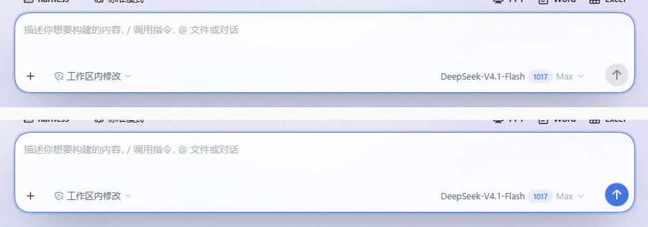

> 没有加"清空 ✕"：那是 iOS **单行** text field 的约定，多行消息输入条（Messages 同款）不带这个按钮，
> 硬加会和草稿、撤销、@ 引用冲突。需要清草稿的话更 Apple 的做法是 `Esc` 快捷键。

## 7. 品牌：换成官方 DeepSeek 标志

官方标志色 `#4D6BFE`，鲸鱼矢量取自应用内原有的官方图形（`viewBox 0 0 23.16 17.04`），
所以是同一只鲸、同一条曲线，只是换了容器和颜色：

| 位置 | 原来 | 现在 |
| --- | --- | --- |
| 侧栏品牌位 `sidebar.brand.mark` | Desktop 自绘的"气泡鲸"（深色） | 官方鲸鱼，品牌蓝，矢量遮罩绘制（任意缩放不糊） |
| 首屏 `conversation.hero.brand.mark` | 官方鲸鱼，但跟随文字色（黑/白） | 官方鲸鱼 + 品牌蓝 |
| 浏览器标签页 favicon | `/dsh-desktop-logo.png` | 官方鲸鱼 SVG（`data:` URI，随插件安装/卸载自动恢复） |
| 应用图标 `resources/icon.png` | Desktop 气泡鲸（黑底） | **透明背景 + 官方鲸鱼（`#4D6BFE`）**，1024² |
| **桌面 / 开始菜单快捷方式图标** | 指向 `DSH Desktop.exe,0`（气泡鲸） | 指向 `%LOCALAPPDATA%\DeepSeek Harness\deepseek.ico`（透明底蓝鲸，多尺寸 16–256） |
| **启动加载页 `resources/splash.html`** | 纯白页面 + 熊猫色 GIF 气泡鲸 | 极光背景 + 玻璃面板 + 官方鲸鱼字标 + 进度光条，亮/暗双主题 |

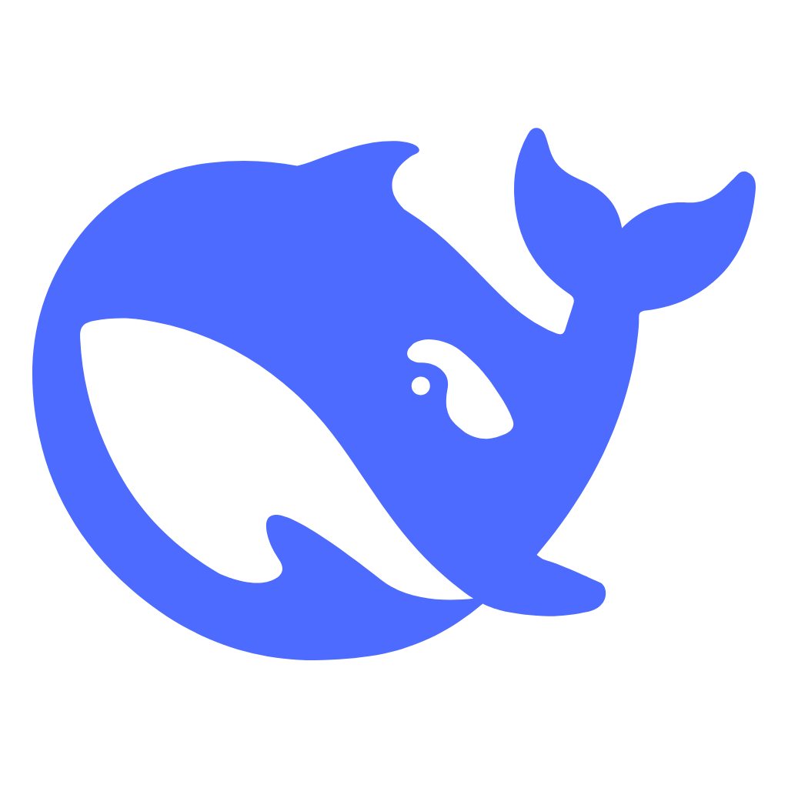

图标**没有底板**：只是蓝鲸本身，透明区域直接露出桌面/任务栏，亮暗背景下都验过可读（16px 仍能认出轮廓）。

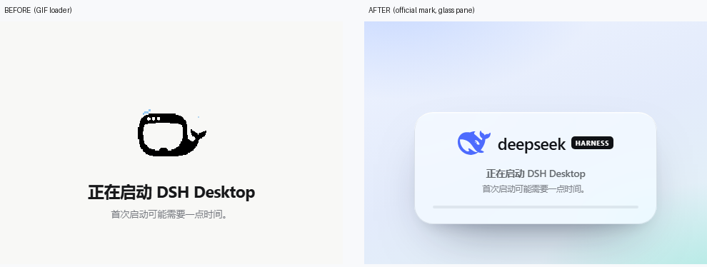

**图标**分两层：`resources/icon.png` 管运行时的窗口/任务栏图标（重启后生效）；桌面和开始菜单的
`.lnk` 把 `IconLocation` 指到了 `%LOCALAPPDATA%\DeepSeek Harness\deepseek.ico`（已刷新 shell 图标缓存，
桌面按 F5 即可）。`DSH Desktop.exe` 里嵌入的 PE 图标（资源管理器直接看 exe 时显示的那个）没有改动 ——
那需要 `rcedit` 重写资源，属于改安装包，单独确认再做。

**启动页**是 `resources/splash.html`，完全自包含（无外部图片、无 GIF）：`?theme=dark` 参数、系统深色、
中英文案切换都和原来兼容，Windows 的 70px 顶部留白也保留了。

回滚：`icon.png.bak-*` → `icon.png`；`splash.html.bak-original` → `splash.html`；
快捷方式 `*.lnk.bak-icon` 改回即可。页面内的三处随插件停用自动恢复。

## 8. 侧栏收起按钮：侧栏内右侧

外壳把「收起侧边栏」画在侧栏标题行的末尾，和品牌字标挤在同一行。插件做的是一枚**镜像按钮**：

- 原按钮保留在 DOM 里（加 `.lg-toggle-origin` 隐藏），继续拥有 React 状态与 `Ctrl+Alt+B` 快捷键；
- 一个 30px 玻璃按钮放在**侧栏内部的右上角**（`left: max(8px, calc(var(--lg-sidebar-edge) - 42px))`，距侧栏内边 12px），**垂直居中对齐 `deepseek HARNESS` 那一行**（`top: var(--lg-sidebar-toggle-top)`，由品牌行的 `getBoundingClientRect()` 中线算出，不是写死的像素）；
- 侧栏宽度同样实时量取写入 `--lg-sidebar-edge`；折叠动画期间用 ~520ms 的 rAF 跟随、窗口缩放也重算；
- **折叠成 46px 窄栏时镜像按钮自动让位**（`hidden`）：那个宽度下外壳会把原按钮变成栏顶的鲸鱼标（点它展开），46px 放不下第二个控件，所以鲸鱼保留、镜像隐藏；
- 图标固定画一枚面板字形，折叠时水平翻转表示「展开」（折叠态下原按钮的图形会变成鲸鱼，不适合直接镜像）；
- 完全不移动 React 节点，不会触发 `removeChild` 之类的框架错误；停用插件即恢复原状。

> 想要「骑在分隔缝上」的把手样式，把 `left` 换成 `calc(var(--lg-sidebar-edge) + 5px)` 并加 `transform: translateX(-50%)` 即可。

## 9. 已经移除的：跟随光标的高光

早先版本会让玻璃表面跟出一团高光（`--lg-px/--lg-py/--lg-lit`）。现已整体删除：
CSS 里不再有 `[data-lg-lit]` 规则与相关渐层，客户端半身只保留**按下**的液态回弹（`data-lg-press`）。
玻璃的高光因此是固定的边缘反射，不再随鼠标移动。

## 10. 深色模式的材质

同一个背景栈里有两层「光落在玻璃上」的装饰：中间一圈白色柔光（`radial 20%`）和顶部一条白边（`linear 28%`）。
它们在亮色下是通透感的来源，原样搬到深色下就是**每块面板凭空多 20~28% 白** —— 这就是深色发灰发白的根因。

现在深色单独一套：

| 层 | 亮色 | 深色 |
| --- | --- | --- |
| 中间柔光 | `rgba(255,255,255,.20)` | `rgba(255,255,255,.05)` |
| 顶部高光 | `rgba(255,255,255,.28)` | `rgba(255,255,255,.07)` |
| 底部厚度 | `rgba(10,18,40,.03)` | `rgba(0,0,0,.22)` |
| 面板底色 | `rgba(255,255,255,.46/.34)` | `rgba(38,42,58,.62)` / `rgba(18,21,31,.52)` |
| backdrop | `brightness(1.0)` | `brightness(0.96)` + `saturate(175%)` |

实测（同一位置取色）：侧栏 `89,87,115 → 51,50,76`，内容区 `51,64,89 → 28,37,58`，输入框 `38,41,56`。

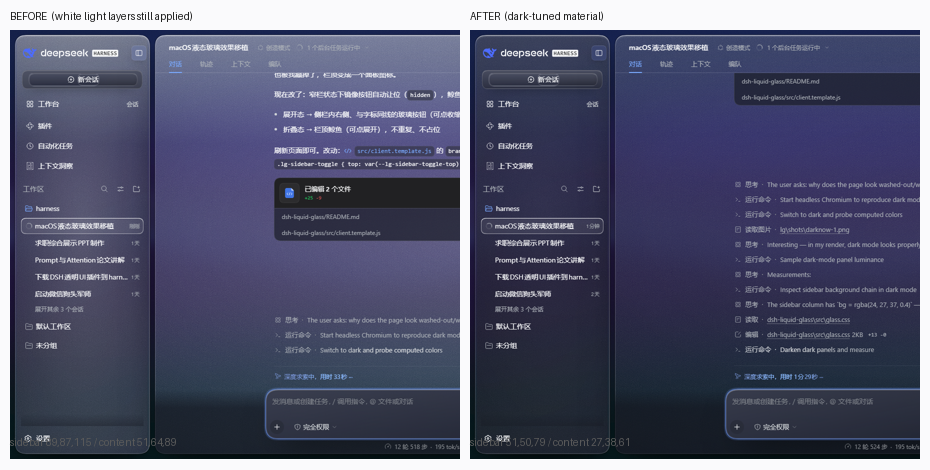

## 11. iOS 液态玻璃：按 Apple 文档校准

依据：[HIG › Materials](https://developer.apple.com/design/human-interface-guidelines/materials)、
[Adopting Liquid Glass](https://developer.apple.com/documentation/technologyoverviews/adopting-liquid-glass)
以及 API 侧 `glassEffect(_:in:)`、`GlassEffectContainer`、`.buttonStyle(.glass)`、
`UIButton.Configuration.glass()`、`UIGlassEffect`。

文档里能直接落到 CSS 的四条：

1. **玻璃是"功能层"**：导航与控件浮在内容之上，内容在下面继续滚动 —— 所以控件用玻璃，内容本身不用；
2. **形状同心**（ConcentricRectangle）：控件更圆，且内圆角 = 外圆角 − 内边距；
3. **iOS 26 的控件是胶囊**：按钮、分段控件、工具栏都是 pill，不是小圆角矩形；
4. **材质自带 vibrancy**：标签在玻璃上保持满强度，不要用灰色小字压上去；
5. `regular` / `clear` 两个变体：regular（模糊 + 调亮度）适合有大量文字的面板，clear 只用于媒体背景。

落地到本插件的改动：

| 项目 | 之前（macOS 味） | 现在（iOS 味） |
| --- | --- | --- |
| 面板圆角 / 外边距 | 26px / 10px | **30px / 12px** |
| 内容页签 | 纯文字 + 蓝色下划线 | **分段控件**：胶囊轨道 + 白色滑块（`role="tablist"` / `role="tab"`），下划线隐藏 |
| 小型控件 | 8px 圆角矩形 | **胶囊**（`border-radius: 999px`）：composer 里的权限/模型 chip、状态 pill、新会话按钮 |
| 控件填充 | 无底 | 半透明胶囊填充 + 1px 高光内描边（iOS 的 fill，而不是只有热区） |
| 菜单 / 弹层 | 16px | **20px**（与面板同族） |
| 输入框 | 28px | **30px** |
| 滚动边缘 | 内容被硬边切断 | **scroll edge**：滚动内容顶部 22px 渐隐（`mask-image`） |

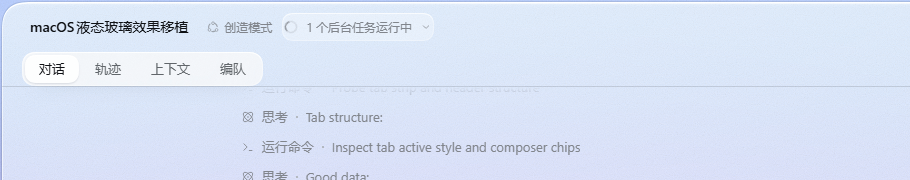

没有做的一件事：把内容区从玻璃改成实心"sheet" —— 文档说内容层不该用玻璃，但那样会丢掉现在整窗通透的观感；
这一条属于产品取舍，需要你点头再动。

## 12. 壁纸：塔希提岛波浪雾

`--lg-wall-image` 换成了一张内联 SVG 的海景（无外部图片依赖）：

- **天际**：顶部冷白 → 海平线处的淡青，右上方一团暖色阳光晕（`#fff4e2`，blur 50）；
- **四层海浪**：由远及近 `#a9e2ea → #70c4d6 → #3d94b0 → #082f43`，越近越深、模糊越小（blur 7 → 2.6），形成纵深；
- **海雾**：海平线上一条 200px 高的白色渐变带 + 两组 blur 20 的白色椭圆，压在浪脊上；
- **浪花**：两条低透明度白色描边贴着浪脊，模拟破碎的白浪；
- **噪点**：`feTurbulence` 颗粒，避免大面积渐变出现色带。
- 构图位置 `center 78%`：把海平线推到窗口上方，让中间正文区域落在海面上。

暗色是同一构图的重配色：天空 `#091420`、海面 `#0d3548 → #020710`、雾改为 14% 的冷蓝。

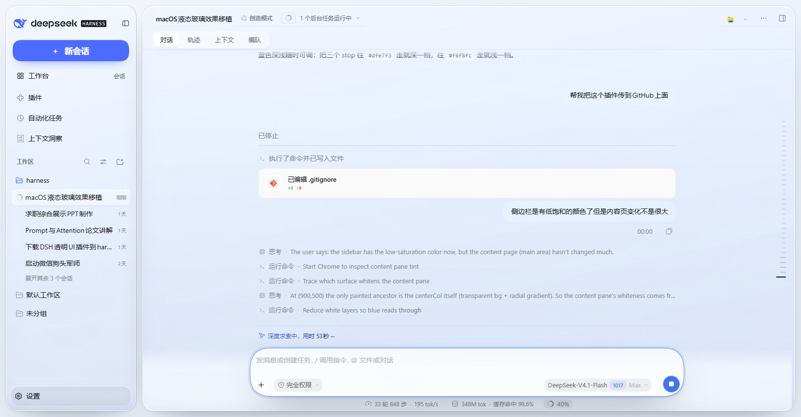

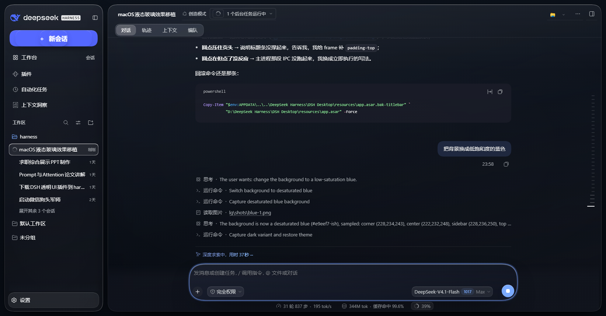

想让海更"透"一点：把 `--lg-panel-a / --lg-panel-b` 往下调（当前 `0.32 / 0.26`）；想要文字更稳就往上加。
## 12. 动态原生壁纸（按时间变色）

背景不再是固定的 SVG，而是**一套按本地时间插值的调色板** —— 和 macOS 的"动态壁纸"同一种行为：
桌面在一天里从清晨的暖粉、正午的亮青、到黄昏的暖紫、入夜的冷蓝，慢慢过渡。

- 调色板是 5 个锚点（05:30 / 09:30 / 14:00 / 18:30 / 21:30），客户端半身按当前时钟在相邻锚点之间做 RGB 插值；
- 每 5 分钟重算一次；切换浅/深色外观时立刻重算（`MutationObserver` 监听 `body[data-ds-dark-theme]`）；
- 深色外观直接用固定的"夜"调色板，不再跟时间走 —— 否则白天也会变成一片黑；
- 壁纸本身是一组 **CSS 径向渐变**（4 团色 + 1 层基底），颜色全部来自 `--lg-w-*` 变量，所以调色板一改，壁纸立刻跟着变，**折射边环也用同一份 paint**，永远和壁纸对齐。

| 时刻 | 主色 | 观感 |
| --- | --- | --- |
| 05:30 | 暖粉 + 淡蓝 | 日出 |
| 09:30 / 14:00 | 亮青 + 米黄 | 正午 |
| 18:30 | 紫 + 橙 + 玫瑰 | 黄昏 |
| 21:30 | 靛蓝 + 藕粉 | 入夜 |
| 深色外观 | 深海蓝 + 冷光 | 夜 |

## 13. 更通透的玻璃

按"要能看到背景画面"的要求，把薄膜和模糊一起放下来：

| 参数 | 之前 | 现在 |
| --- | --- | --- |
| `--lg-panel-a / -b`（面板薄膜） | 0.32 / 0.26 | **0.26 / 0.18** |
| `--lg-blur`（背板模糊） | 28px | **18px** |
| `--dsw-specific-sidebar-fill` | 0.34 | **0.16** |
| 中央柔光 | 0.10 | 0.10（保持，负责正文可读性） |

正文仍是 `label-primary` 深色，实测在五个时段调色板下都保持可读；如果想让画面更"透"，继续往下调前三个值即可。


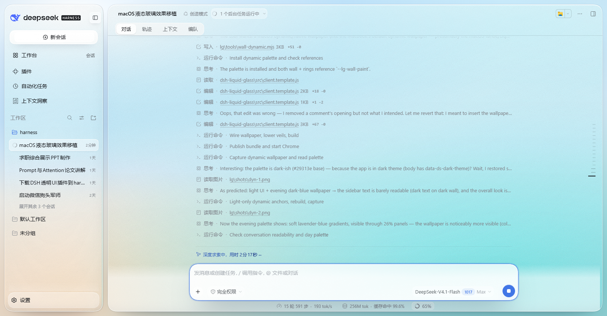

## 14. 无面板：文字直接压在壁纸上

最后一步把"面"本身去掉了 —— 不是调透明度，是**撤销面板这个表面**：

```css
[class*="sidebarCol"], [class*="centerCol"] {
  background: none; backdrop-filter: none; box-shadow: none;
  border-radius: 0; margin: 0;
}
/* 折射边环与高光扫过一并关闭 */
::before, ::after { display: none; }
```

于是导航、标题、正文、工具卡全部直接落在动态壁纸上，玻璃只留在**控件**上（输入框、菜单、按钮、分段控件、侧栏收起键）。

两处补偿，保证文字不"糊"：

- 侧栏右缘留一条 `inset -1px` 的发丝线（`rgba(15,23,42,.08)` / 深色 `rgba(255,255,255,.08)`），否则两栏会连成一片；
- 正文与列表加 1px 的极淡文字投影（亮色白影 / 深色黑影），在壁纸的高光区也能保持笔画边界。


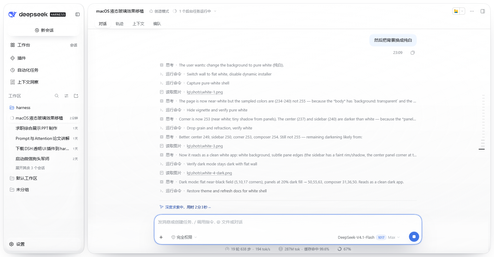

## 15. 最大透明（面回来了）

第 14 节的"无面板"已撤销：面回来了，但**填充压到最低**，靠边缘而不是靠身体去说明"这是一块玻璃"。

| 参数 | 无面板前 | 现在（最大透明） |
| --- | --- | --- |
| `--lg-panel-a / -b`（亮） | 0.32 / 0.26 | **0.12 / 0.06** |
| `--lg-panel-a / -b`（暗） | 0.62 / 0.52 | **0.20 / 0.12** |
| `--lg-blur` | 18px | **10px** |
| 侧栏填充 token | 0.16 | **0.06** |
| 输入框薄膜 | 0.84 / 0.58 / 0.74 | **0.62 / 0.40 / 0.52** |
| 边缘（高光边 / 描边 / 折射环 / 投影） | 保留 | **全部保留** |

保留了第 14 节的文字投影补偿：填充几乎为零时，文字在壁纸高光处的笔画边界靠那 1px 微影撑住。


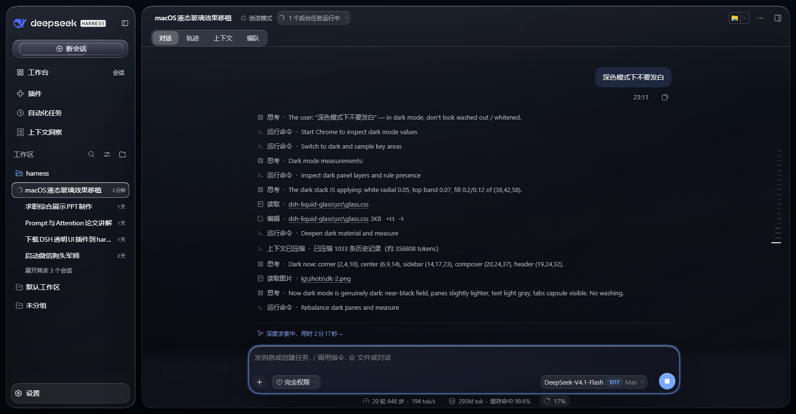

再往下调（比如 0.06 / 0.03）就会接近第 14 节的"只剩边缘"状态；玻璃的"存在感"就全靠 `box-shadow` 的那圈高光了。

## 16. 收起按钮：从"卡片"变成"图标"

之前那个按钮自带玻璃小方块（亮色 `white .46`、暗色 `white .05`），在近乎全透明的面板上就是一块**异物**；深色下 `5% 白` 又比背景亮一档，于是"颜色对不上"。

现在按外壳自己图标的规格重做：

```css
.lg-sidebar-toggle {
  background: transparent;   /* 平时没有底 */
  box-shadow: none;
  backdrop-filter: none;
  color: var(--dsw-alias-label-secondary);
}
.lg-sidebar-toggle:hover { background: rgba(15,23,42,.06); color: var(--dsw-alias-label-primary); }
body[data-ds-dark-theme] .lg-sidebar-toggle:hover { background: rgba(255,255,255,.09); }
```

- 静止状态**只有一个图标**，颜色与 `deepseek HARNESS` 同一档（`label-secondary`），所以亮/暗两种外观下都不会和背景脱节；
- 悬停才浮现 6% 的浅底（暗色 9%），和标题栏里其它图标按钮的行为完全一致；
- 按下仍是 `scale(.94)` 的液态回弹，键盘聚焦仍有 2px 强调色焦点环。

## 17. 纯白底

背景换成纯白，动态壁纸退场（`installWallpaper()` 保留但不再挂载，随时可以接回来）：

```css
html.lg-on { --lg-wall-paint: #ffffff; }
html.lg-on body[data-ds-dark-theme] { --lg-wall-paint: linear-gradient(168deg, #0b1420, #070d16 52%, #05090f); }
```

顺手关掉三样"只对画面有意义"的东西：

| 东西 | 原因 |
| --- | --- |
| `.lg-vignette`（四角压暗） | 纯色底不需要暗角，留着会让白色变成 234 |
| 面板的噪点层 | `overlay` 混合在大面积白色上会压到 237，白得不干净 |
| 折射边环 / 高光扫过 | 纯色没有可折射的内容，只会变成一圈无意义的亮带 |

结果：亮色取色 253–255（残余是面板自己的柔投影，用来分栏），深色 `#05090f`。玻璃现在只剩**填充 + 高光边 + 柔投影**三件事，正好是一块"贴着白纸的玻璃"。


## 18. 深色不发白

深色下的"发白"不是一处，是四层叠出来的：

| 来源 | 原来 | 现在 |
| --- | --- | --- |
| 面板白柔光 `radial` | `white .05` | **`.025`** |
| 面板顶部白边 `linear` | `white .07` | **`.04`** |
| 内高光（亮色那套 85% 白 inset） | 深色下仍在 | **整条移除**，只留 26% 的边光 |
| `backdrop-filter` | `saturate(175%) brightness(.96)` | **`saturate(150%) brightness(.9)`** |
| 面板填充 | `rgba(38,42,58,.20)` | **`rgba(32,36,46,.50)`**（更暗、更实） |
| 深色壁纸 | `#0b1420 → #05090f` | **`#070d16 → #020409`** |
| 输入框 | `rgba(60,64,80,.62)` | **`rgba(38,42,54,.50)`** |

实测（同一坐标）：角 `5 → 2`、内容区 `42 → 10`、侧栏 `52 → 17`、输入框 `31 → 20`、标题栏 `58 → 24`。

要点：深色不是"把亮色调暗"，而是**把亮色那套"光落上去"的图层几乎全部撤掉**，再用一块更暗更实的面板把文字托住 —— 亮度靠 `brightness(.9)` 压，不靠加白。

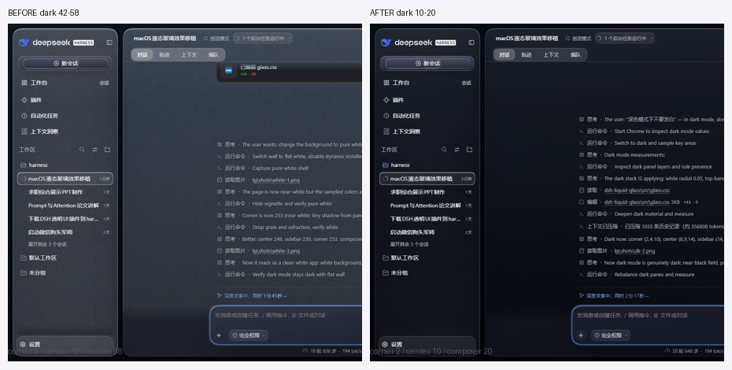

## 19. 新会话输入框：iOS 规格

按 iOS 26 的输入条重做（不再是 macOS 那种圆角卡片）：

| 项目 | 之前 | 现在 |
| --- | --- | --- |
| 形状 | 30px 圆角矩形 | **胶囊 `border-radius: 999px`**（两端全圆） |
| 焦点环 | `1.5px 70% 强调色 + 4px 16%` | **`1.5px 52% + 5px 12%`**（更软，iOS 不发在发光） |
| 内部小控件 | 无底 | **6% 深色胶囊 + 1px 白高光**（`button[trigger]`、`pill`） |
| 占位文字 | 亮色灰 | `secondaryLabel`，暗色 55% 白 |
| 发送键 | 34px 圆 | 34px 圆，**无内容时中性灰**、有内容才上强调色（Messages 模型） |
| 光标 / 选区 | — | 强调色（`caret-color` + `::selection`） |

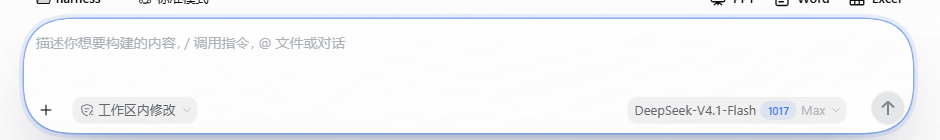

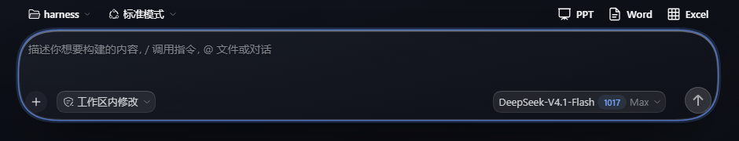

一行就能看到区别的地方：**两端是半圆**（胶囊），而不是"圆角矩形"；控件在胶囊里是**小胶囊**，不是文字裸排。

## 20. 侧边栏 / 顶栏：iOS 列表与导航栏

| 部位 | 之前 | 现在（iOS） |
| --- | --- | --- |
| 侧栏行 | 8px 圆角、悬停无反馈 | **10px 圆角 + 6% 悬停填充**（iOS 列表行） |
| 行高 | 36px | **38px**（更接近 44pt 的密度） |
| 分组标题 | 常规字号 | **11.5px / 600 / secondary**，`padding: 6px 10px 4px` |
| 新会话 | 白色胶囊（白底上不可见） | **7% 深色胶囊 + 1px 白内描边**（暗色 9% 白） |
| 顶栏 | 无分隔 | **底部 1px 发丝线**（亮 5.5% 深 / 暗 7% 白） |
| 标题 | 15px | **17px / 600 / −0.01em**（iOS 导航栏标题） |
| 右上工具键 | 方形图标 | **30px 圆形、无底、悬停才浮现**（`border-radius: 999px`） |
| 页签 | 文字 + 下划线 | 胶囊分段控件（第 11 节） |

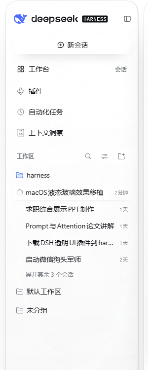

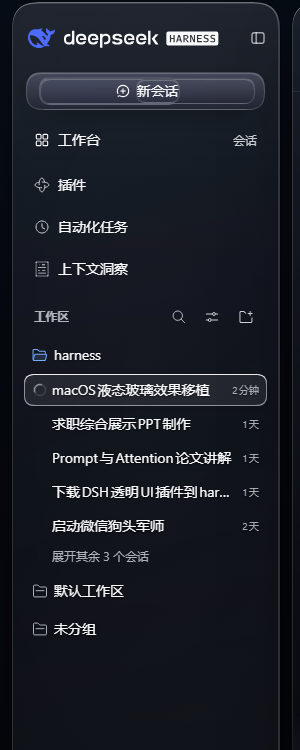

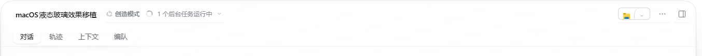

有意没做的：iOS 的"inset grouped"列表（卡片内缩、行间分隔线、右侧 `chevron`）。DSH 的侧栏是桌面级导航，加 chevron 会骗人（没有下一级），加分隔线在 270px 宽里也太密 —— 保留列表的"行"语义就够了。

## 21. 新会话键：iOS 的 prominent capsule

| 规格 | 值 |
| --- | --- |
| 形状 | 胶囊 `border-radius: 999px`，无边框 |
| 高度 | **44pt**（iOS 标准控件高度） |
| 文字 | **17pt / 600 / −0.01em**，纯白 |
| 填充 | 亮 `#4d6bfe`（品牌蓝），悬停 `#5b76ff`，按下 `#4460f0` + `scale(.975)`；暗色 `#5568ff` |
| 高光 | `inset 0 1px 0 rgba(255,255,255,.32)` —— iOS 用内高光而不是描边 |
| 投影 | 强调色投影 `0 10px 22px -14px rgba(77,107,254,.95)` |
| 快捷键提示 | **隐藏**（iOS 按钮不印快捷键） |
| 键盘焦点 | 2px 强调色环，`outline-offset: 2px` |

### 两个坑

1. **优先级打架**：文件里原本有三处 `[class*="newSession"]` 规则，旧的（`background: linear-gradient(...) !important` + 暗色兄弟选择器）spec 更高，把新规则压掉了 —— 表现是"怎么改都不生效"。删掉旧块、新块加 `!important` 才生效。
2. **`background-clip: text`**：外壳把按钮文字做成了"用继承来的背景图裁成文字"（`newSessionLabelMask` / `newSessionContent` 就是干这个的）。所以给按钮刷成实色时，文字会变成蓝色消失，而它内部的容器还会留下一块浅色板 —— 必须同时给内层 `background: transparent` + `-webkit-text-fill-color: #fff`。

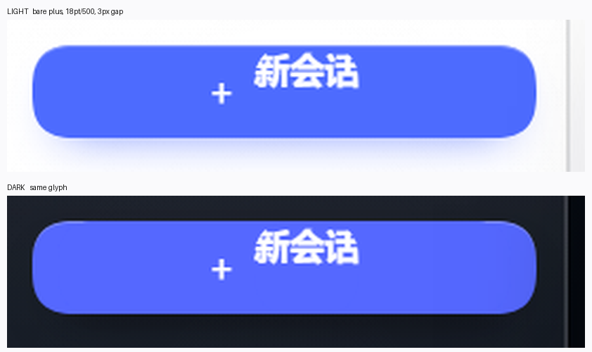

## 22. 新会话键的图标：去掉"放大镜"

外壳给的图标是**圆圈里一个加号**。16px 下圆环 + 中间的竖笔，视觉上就是一个放大镜。iOS 的 New 按钮用的是**裸加号**，所以：

```css
html.lg-on [class*="newSession"] svg { display: none !important; }
html.lg-on [class*="newSessionContent"]::before {
  content: "+";
  font-size: 18px; font-weight: 500; margin-right: 3px;
  color: #fff; transform: translateY(-1px);
}
```

- 隐藏原来的 SVG（不是重画，避免破坏按钮的 mask 动效）；
- 用伪元素画一个裸 `+`，18pt/500，距文字 3px，纯白；
- 亮/暗两套颜色一致（文字本身就是 `#fff`）。


## 23. 新会话：撤销按钮，回到一行字

用户要的是"正常的文字"，所以第 21/22 节的蓝色胶囊**整个撤掉**：

| 项目 | 胶囊版 | 现在 |
| --- | --- | --- |
| 背景 | `#4d6bfe` 实色 | **透明** |
| 阴影 / 边框 | 强调色投影 + 内高光 | **全无** |
| 圆角 | 999px | 10px（仅悬停时露出 5% 灰底） |
| 文字 | 17pt/600 白色 | **14pt/500 label-primary**，与其它导航行同档 |
| 动效 | 0.16s 颜色过渡、按下 `scale(.975)` | **全部 `transition: none` / `transform: none`** |
| 图标 | 圈+（已改裸 `+`） | 裸 `+`，15pt，继承文字色 |

同时清掉了三处残留的 `newSession` 规则（蓝色 hover/active、暗色实色块、999px 圆角），那些是"怎么改都不生效"的根源 —— specificity 更高的旧规则一直在覆盖新规则。

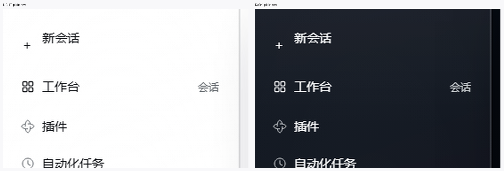

想要胶囊回来：把本节的 `background/box-shadow/border-radius` 三条恢复成第 21 节的值即可，两节的内容都在文件里。

## 24. 新会话回蓝 + 顶部两组键按 macOS 来

**第一步：新会话**

- 背景恢复 `#4d6bfe` 胶囊（暗色 `#5568ff`），高光边 + 强调色投影；
- **内容居中**：外壳的 `newSessionLabelMask` / `newSessionContent` 是各自独立的 flex 容器，只给按钮 `justify-content: center` 会把加号甩到左边 —— 三个包装层都要 `inline-flex + justify-content: center`；
- **同一水平线**：`line-height: 1` + `align-items: center`，加号再 `translateY(-0.5px)` 做光学对齐；
- 清掉两个包装层残留的边框/投影（之前会在胶囊里留下两圈浅色弧线）。

**第二步：顶部键**

| 位置 | 对象 | macOS 规格 |
| --- | --- | --- |
| 右上三个 | 打开方式（主+箭头）、更多操作、右侧栏 | **无边框**、7px 圆角、`transparent`，悬停 6% / 按下 12% |
| 右上分组 | 打开方式的主键与箭头 | 一个胶囊：相接处直角、外侧圆角、中间 1px 分隔线 |
| 左上两个 | 品牌键、收起侧栏键 | 同一套几何（7px 圆角、悬停才有底） |
| 标题行两个 chip | 创造模式、后台任务 | **macOS popup button**：6px 圆角 + 1px 发丝描边 + 12pt 次级字色 |

关键一条：**`[role="tab"]` 必须排除**。第一版把 `header button` 统一改成无底，结果分段控件的白色滑块也被抹平，四个页签变成纯文字 —— macOS 工具栏按钮和分段控件是两种语言。

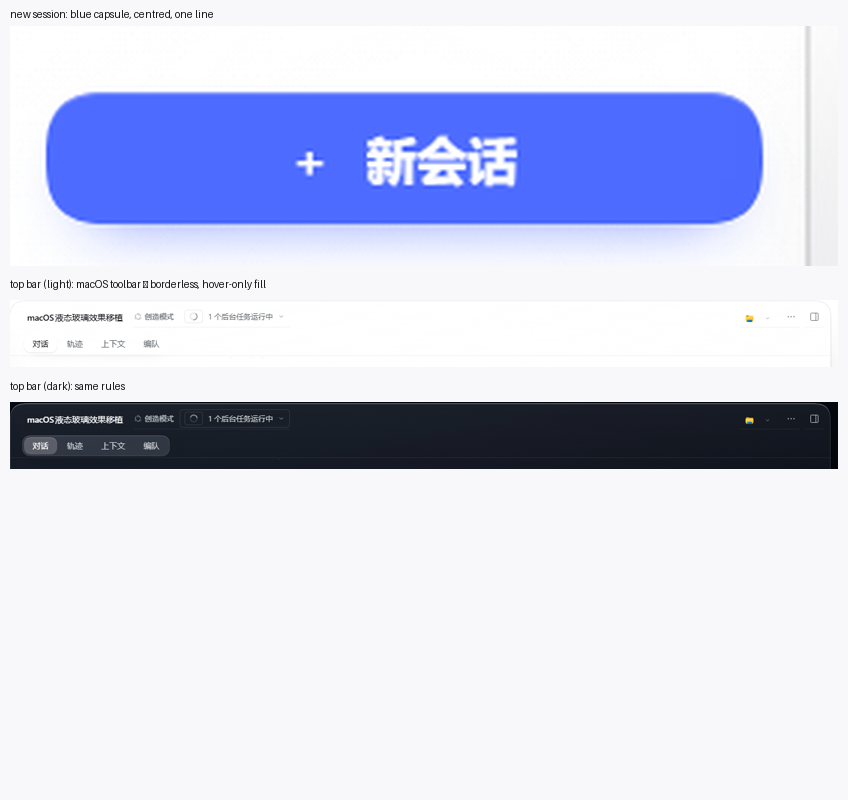

## 25. 选择面板的可读性修复

用户在提问面板里反馈"选项被遮挡、可读性差"。两个真凶：

1. **滚动渐隐 mask** —— 第 11 节给 `[class*="scrollBody"]` 加了 `mask-image: linear-gradient(transparent 0, #000 22px)` 做 iOS 的 scroll edge。但提问卡片也活在滚动容器里，于是卡片顶部 22px 被真的"渐隐"掉了 —— 看起来就是"被什么东西挡着"。
   **已移除**这条 mask（`scrollBody` 不再裁剪顶部）。
2. **浮动收起键压在模态之上** —— 它 `z-index: 60`，而模态层的层叠上下文更低时会浮在上面。现在只要页面上存在 `[aria-modal="true"]` 或 `[role="dialog"]`，收起键直接 `display: none`。

另外给选项行补了它们自己的面（避免和背后的玻璃糊在一起）：

```css
[class*="nUhMVa_choice"] { background: rgba(255,255,255,.88); border-radius: 10px;
                           box-shadow: inset 0 0 0 1px rgba(13,21,38,.1); }
[class*="nUhMVa_choiceTitle"], [class*="nUhMVa_choiceNote"] { opacity: 1; }
```

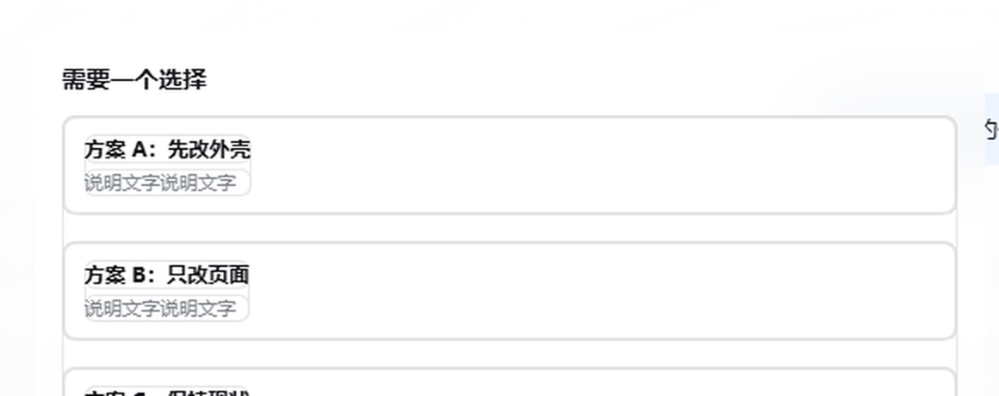

## 26. 外壳补丁：macOS 红黄绿窗口按钮

Windows 的 关闭/全屏/最小化 是 Electron 的 `titleBarOverlay` 画的，不在网页里，CSS 永远碰不到。所以这一项改的是外壳：

| 改动 | 位置 | 内容 |
| --- | --- | --- |
| 去掉原生按钮 | `out/main/index.js` | 删除 `titleBarOverlay: windowsTitleBarOverlay(...)`，窗口仍是无边框 `hidden` |
| 窗口 IPC | `out/main/index.js` | 末尾追加 `import("electron")` → `ipcMain.on("lg:window", …)`：`min` / `max` / `close` |
| 桥 | `out/preload/index.cjs` | 末尾追加 `contextBridge.exposeInMainWorld("lgWindow", { minimize, toggleMaximize, close })` |
| 按钮 | `src/client.template.js` | `installTrafficLights()`：只在 `window.lgWindow` 存在时渲染三个 12px 圆点（右上下 14px、间距 8px），点击走桥 |

红黄绿顺序按 Windows 的位置排（左→右：最小化 / 全屏 / 关闭），悬停才显示符号，和 macOS 一致。

补丁脚本：[`lg/tools/patch-titlebar.cjs`](../lg/tools/patch-titlebar.cjs)
- `node patch-titlebar.cjs` 应用（先写 `app.asar.new`，逐文件校验 SHA-256，0 失败才替换，并自动备份 `app.asar.bak-titlebar`）
- `node patch-titlebar.cjs --restore` 一键还原
- `--dry` 只校验不替换

踩到的两个坑：asar 头部的 pickle 长度字段是嵌套的（`u32@4 = 4 + u32@8`、`u32@8 = 4 + jsonLen + pad`），算错 1 字节会让所有 offset 偏移、全档校验失败；另外外壳带了 `corner-shape: squircle`，"圆"要用 `corner-shape: round` 才能真的变圆。

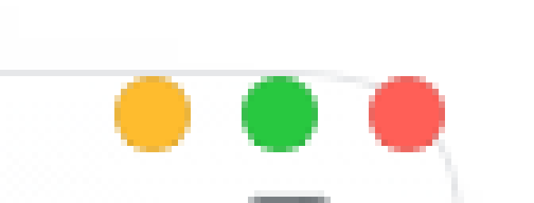

## 27. 背景：低饱和蓝

纯白换成一层**低饱和度的蓝**（几乎是无彩的冷灰蓝，饱和度 8–12%）：

```css
html.lg-on { --lg-wall-paint: linear-gradient(168deg, #f2f5fa 0%, #e9eef7 52%, #e3e9f3 100%); }
html.lg-on body[data-ds-dark-theme] { --lg-wall-paint: linear-gradient(168deg, #0d131c 0%, #090e16 52%, #060a11 100%); }
```

取色（同一坐标）：角 `228,234,243`、内容区 `222,232,248`、侧栏 `228,236,250`、顶栏 `242,247,255` —— 蓝相在 215–220°、饱和度 10% 上下，属于"看得见是蓝、但不会抢内容"的档位。

深色跟着往冷蓝偏了一格（`#0d131c` 起）。因为底色不再是纯白，面板那圈 12% 的白薄膜才终于看得出来是"玻璃"。


## 28. 蓝底：把内容页的白层也压下去

换成低饱和蓝之后只有侧栏看得出来，内容页还是白的 —— 因为**内容页比侧栏多两层白**：

| 层 | 之前 | 现在 |
| --- | --- | --- |
| 面板映射 `--lg-panel-a / -b` | 0.12 / 0.06 | **0.07 / 0.035** |
| 中央柔光 `radial` | 0.10 | **0.045** |
| 顶部白边 `linear` | 0.28 | **0.12** |

取色对比（同一 y）：侧栏 `226,235,251`、内容区 `223,234,251`、壁纸角 `228,234,243` —— 三块现在在同一个色阶上，蓝能透上来。

原来那两层白是为"纯白底"服务的：白底上不压白就看不出玻璃。底色变蓝之后它们的唯一作用就是把蓝洗掉。
